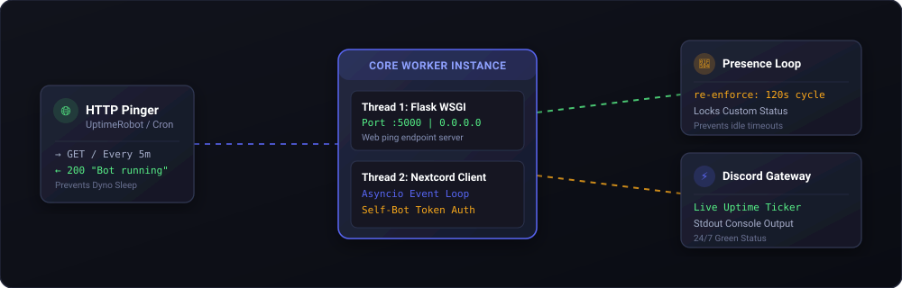
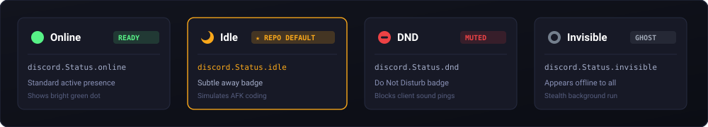

<p align="center">
  
</p>

<p align="center">
  <a href="https://www.python.org/downloads/"></a>
  <a href="https://nextcord.readthedocs.io/"></a>
  <a href="https://flask.palletsprojects.com/"></a>
  <a href="https://github.com/Profrozer/Full-Time-Discord-Bot/blob/main/LICENSE"></a>
  <a href="https://github.com/Profrozer/Full-Time-Discord-Bot/stargazers"></a>
</p>

---

##  Overview

**Full-Time Discord Bot** is an ultra-lightweight, autonomous self-presence daemon engineered in Python. It maintains persistent 24/7 account activity, broadcasts custom activity messages, tracks live uptime dynamically in your terminal, and runs an internal Flask HTTP heartbeat to prevent cloud instances (Render, Railway, Replit, Heroku, VPS) from sleeping.

- **Non-stop presence**: Automatically re-applies status every 120 seconds to prevent Discord gateway timeouts.
- **Dynamic stdout metrics**: Real-time colored terminal dashboard with running uptime counters.
- **Dual-thread architecture**: Runs an asynchronous Discord WebSocket client alongside a Flask WSGI keep-alive webserver.

---

##  Architecture & Signal Flow

The daemon concurrently spawns a Flask webserver thread to answer external uptime pingers while running the Nextcord asyncio event loop for gateway maintenance:

<p align="center">
  
</p>

---

##  Presence Modes

Customize your visible status inside `main.py` by switching the `status_value` enum:

<p align="center">
  
</p>

```python
# main.py - lines 19-20
status_value = discord.Status.idle            # online | idle | dnd | invisible
custom_status = "Coding/Cracking 24/7"        # Your custom text status
```

---

##  Quick Start

### 1. Clone Repository

```bash
git clone https://github.com/Profrozer/Full-Time-Discord-Bot.git
cd Full-Time-Discord-Bot
```

### 2. Install Dependencies

On Windows:
```cmd
Install-requirements.bat
```

Or via pip on Linux / macOS / Windows:
```bash
pip install -r requirements.txt
```

### 3. Configure Discord Token

Set your Discord Token as an environment variable (never hardcode credentials into source files):

**Linux / macOS:**
```bash
export DISCORD_TOKEN="your_discord_token_here"
```

**Windows (PowerShell):**
```powershell
$env:DISCORD_TOKEN = "your_discord_token_here"
```

**Windows (CMD):**
```cmd
set DISCORD_TOKEN=your_discord_token_here
```

### 4. Run the Daemon

```bash
python main.py
```

Console output upon initialization:

```text
┏━━━━━━━━━━━━━⍟
┃ Account: Profrozer#0001
┃ Status: Idle
┃ Custom Status: Coding/Cracking 24/7
┃ Account ID: 123456789012345678
┗━━━━━━━━━━━━━⊛
Account has been active for: 04h 12m 38s
```

---

##  24/7 Cloud Hosting (No-Sleep Setup)

To keep your bot active continuously for free or on a VPS:

| Platform | Deployment Method | Keep-Alive Integration |
|:---|:---|:---|
| **Render** | Web Service (`gunicorn wsgi:app` or `python main.py`) | Ping `https://your-app.onrender.com/` with [UptimeRobot](https://uptimerobot.com) |
| **Railway** | Deploy from GitHub repo | Automatic background daemon container |
| **Replit** | Run `main.py` | Add Replit Webview URL to UptimeRobot |
| **Linux VPS** | Run via `systemd` or `pm2` / `tmux` | Native 24/7 daemon process |

### Example Systemd Service (`/etc/systemd/system/discord-presence.service`)

```ini
[Unit]
Description=Discord Full-Time Presence Daemon
After=network.target

[Service]
Type=simple
User=ubuntu
WorkingDirectory=/home/ubuntu/Full-Time-Discord-Bot
Environment=DISCORD_TOKEN="your_token_here"
ExecStart=/usr/bin/python3 main.py
Restart=always
RestartSec=10

[Install]
WantedBy=multi-user.target
```

---

##  Repository Structure

```text
Full-Time-Discord-Bot/
├── assets/
│   ├── hero-banner.svg     # Theme-native animated SVG hero
│   ├── architecture.svg    # Signal & thread orchestration diagram
│   └── status-matrix.svg   # Discord status reference cards
├── Install-requirements.bat # Windows automated dependency installer
├── main.py                 # Core presence engine & Flask server
├── requirements.txt        # Python package dependencies
├── wsgi.py                 # WSGI entrypoint for cloud web servers
└── README.md               # Documentation & deployment guide
```

---

## ⚠️ Disclaimer

This project implements self-bot functionality using user tokens to automate account presence. Automating user accounts is contrary to the [Discord Terms of Service](https://discord.com/terms). Use this repository responsibly and at your own discretion.

---

## 📄 License

This project is licensed under the [MIT License](LICENSE).
